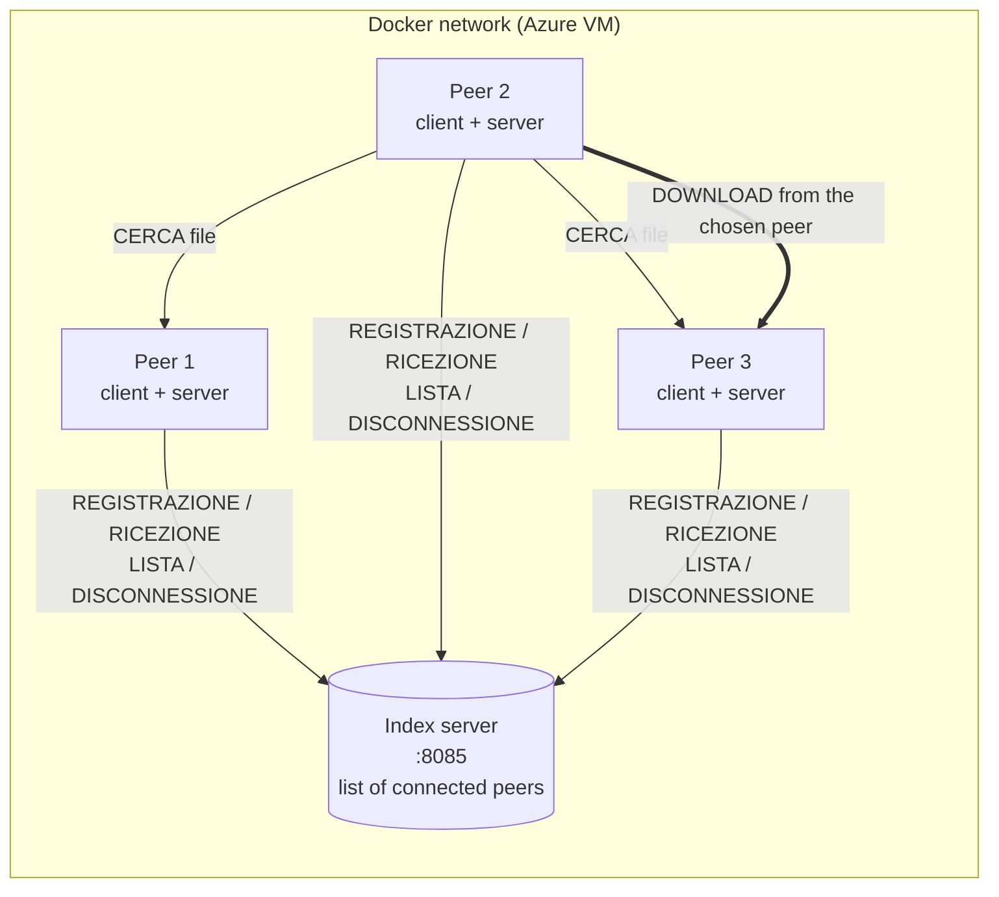

# Peer-to-peer file sharing in Java (index server + peers, Docker, Azure)

A distributed file-sharing service built on plain **Java sockets and threads**. An **index server** keeps track of the peers in the network. Each **peer** is at the same time a **client** (it searches the network and downloads files) and a **server** (it answers searches and sends files). The system was deployed on a **Microsoft Azure** VM, with every node in its own **Docker** container on a dedicated network.



## What it does
1. A peer starts its own server side and **registers** with the index server, which replies with the list of connected peers.
2. The user **searches a file by name**. The peer refreshes the peer list, shows which files the network offers, and sends a `CERCA` request to **every active peer**.
3. Among the peers that answer `TROVATO`, it **picks one at random** and downloads the file from it in a **background thread**, so the user can keep working. The other peers keep no state about the request, so nothing needs to be cancelled.
4. When a peer receives a `DOWNLOAD` request, it streams the file from its shared folder.
5. On `TERMINA` the peer stops accepting requests, **waits for the downloads in progress**, then sends `DISCONNESSIONE` to the index server.

### Protocol
Every request opens a new TCP connection. Messages are Java-serialised objects.

| To | Request | Payload | Reply |
|---|---|---|---|
| Index server | `REGISTRAZIONE` | the peer (IP, port, shared files) | list of connected peers |
| Index server | `RICEZIONE` | – | updated list of peers |
| Index server | `LISTA` | – | map IP → shared files |
| Index server | `DISCONNESSIONE` | the peer | acknowledgement |
| Peer | `CERCA` | file name | `TROVATO` + the peer, or `NIENTE` |
| Peer | `DOWNLOAD` | file name (UTF) | raw file bytes |

Concurrency:
- every incoming connection is handled by its own thread, on both the index server and the peers;
- the index server synchronises on the peer list;
- each download runs in its own thread, and the threads are joined when the peer shuts down.

## Run it
Requirements: JDK 14 or later (the code uses switch expressions).

```bash
make                                   # build/IndexServer.jar, build/PeerClientServer.jar

java -jar build/IndexServer.jar        # terminal 1: listens on port 8085, type TERMINA to stop
java -jar build/PeerClientServer.jar demo/peer_    # terminals 2, 3, ...: one per peer
```
Both programs are interactive. A peer asks for:
- its own port (e.g. 9001);
- its ID: peer N shares the folder `demo/peer_N` and saves downloads to `demo/peer_N/download`;
- the index server's address and port (`127.0.0.1` and `8085`);
- then, in a loop, the operation: `0` search and download, `1` stay idle for a given time, `2` terminate.

### With Docker (one container per node, as in the Azure deployment)
```bash
docker compose up -d --build
docker attach --sig-proxy=false p2p-peer1   # port 9001, ID 1, index server "indexserver", port 8085
docker attach --sig-proxy=false p2p-peer2   # in another terminal: port 9002, ID 2, ...
docker compose down                         # stop everything
```
The prompts printed before you attach are in `docker logs p2p-peer1`. Ctrl-C detaches without stopping the container. The `demo/` folder is mounted into every peer at `/app/data`, so downloaded files appear on the host (owned by root, because the containers run as root).

## Tested
**Local** (JDK 17): an end-to-end run used an index server and 3 peers, driven through their interactive prompts:
- all peers register;
- a search for `hello.txt` finds the **2 peers** that share it and downloads it from one of them;
- a 200 KB binary file arrives **byte-for-byte identical**;
- `TERMINA` waits for both running downloads before disconnecting.

**Docker** (Docker 29, Compose 2.40): `docker compose up --build` starts the 4 containers on the `p2p` network, each with its own IP. The same test was then driven through `docker attach`, with the peers reaching the index server by its service name `indexserver`. All 3 peers register, both downloads reach the host through the `demo/` volume (the binary file byte-for-byte identical), the peer exits cleanly after waiting for them, and `docker compose down` leaves nothing behind.

### Fixes compared with the course submission
- **Every downloaded file was corrupted by 4 extra bytes** at the start (`AC ED 00 05`). The sending peer opened an `ObjectOutputStream` on the socket before knowing the request type, and its serialisation header ended up in front of the file. The stream is now created only to answer `CERCA`.
- **Peer selection never picked the last peer** that had the file: `nextInt(size - 1)` became `nextInt(size)`.

### Known limitations
- Java serialisation over plain TCP, with no authentication. This is a teaching prototype, meant for a trusted network only.
- The `LISTA` map is keyed by IP, so peers running on the same host overwrite each other in the file listing (search and download are not affected).
- A peer announces the files present at start-up. Peers that crash without `DISCONNESSIONE` stay registered (there is no heartbeat).
- Transfers include a **simulated delay of 10–50 s**, used in the demo to show that shutdown waits for the downloads in progress.

## Repository structure
```
src/NodoIndexServer/   IndexServer (accept loop), RichiesteServerHandler (one thread per request)
src/NodoPeer/          PeerClientServer (client side + server side), RichiestePeerHandler (CERCA / DOWNLOAD)
demo/peer_N/           sample shared folders
Dockerfile, docker-compose.yml
docs/REPORT.md         technical report: requirements, design, deployment on Azure and Docker, tests
```

## Author
**Silvio Raso** ([@codingsr-01](https://github.com/codingsr-01))

Project for *Sistemi Distribuiti e Cloud Computing* (Prof. Domenico Talia, Prof. Loris Belcastro), MSc in Computer Engineering, University of Calabria, A.Y. 2021/22.

## License
[MIT](LICENSE)
