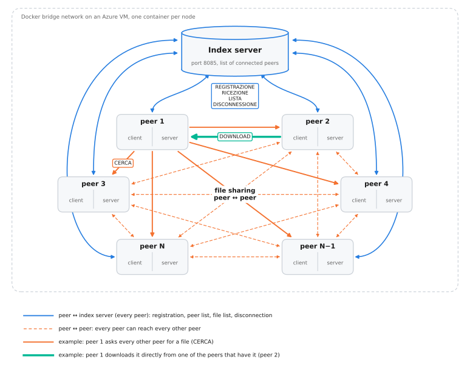
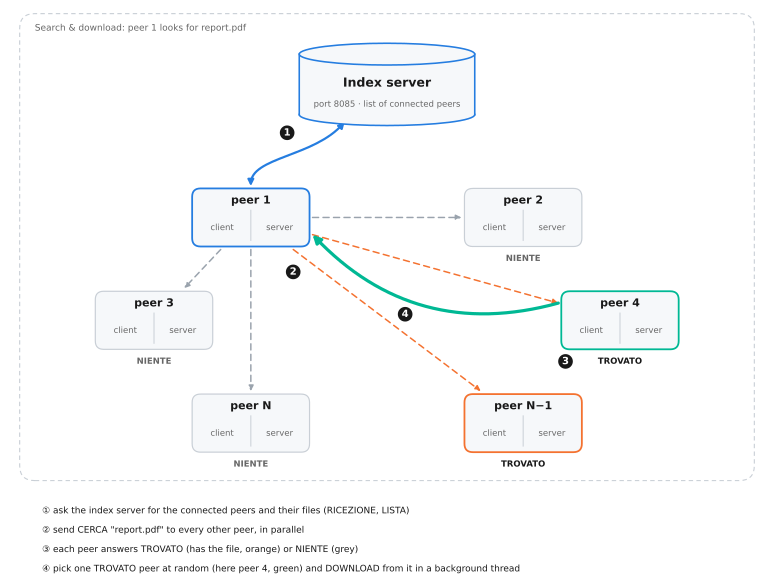

# Peer-to-peer file sharing in Java


## Abstract
This project implements a **distributed peer-to-peer file-sharing service** in Java, using only TCP sockets, threads and object serialisation, with no middleware or external libraries. An **index server** keeps the list of the connected peers and of the files they share. Every **peer** is at the same time a client, through which the user searches for files by name, and a server that answers the requests of the other peers. To find a file, a peer gets the current list of peers from the index server and asks all of them in parallel whether they have it. Among those that answer positively, one is chosen at random and the file is downloaded directly from it in a background thread, so file contents never pass through the index server. When the user quits, the peer stops accepting requests, waits for its downloads in progress to finish and then deregisters from the index server. Every node runs in its own **Docker** container, and the system was deployed on a **Microsoft Azure** virtual machine. A Docker Compose setup runs the whole network on a single machine.

**Keywords:** distributed systems, peer-to-peer, sockets, multithreading, Docker, Microsoft Azure

<p align="center">
<picture>
  <source media="(prefers-color-scheme: dark)" srcset="assets/architecture-dark.svg">
  
</picture>
</p>

## Contents
- [How it works](#how-it-works)
- [Protocol](#protocol)
- [Run it](#run-it)
- [Example session](#example-session)
- [What was tested and fixed](#what-was-tested-and-fixed)
- [Limitations](#limitations)
- [Repository structure](#repository-structure)

## How it works
There are two kinds of node:

| Node | Role |
|---|---|
| **Index server** (port 8085) | Keeps the list of connected peers and the files each one shares. It answers registration, peer-list, file-list and disconnection requests, each in its own thread. |
| **Peer** | **Client side**: a menu loop driven by the user (search & download, idle, terminate). **Server side**: a `ServerSocket` that answers `CERCA` (do you have this file?) and `DOWNLOAD` (send it) from other peers, again one thread per request. Each peer shares one folder, `peer_<ID>/`. |

A search and download takes four steps:

<p align="center">
<picture>
  <source media="(prefers-color-scheme: dark)" srcset="assets/search-download-dark.svg">
  
</picture>
</p>

1. **Refresh the network.** The peer asks the index server for the connected peers (`RICEZIONE`) and the files they share (`LISTA`).
2. **Search everywhere.** It sends `CERCA "<file>"` to every other peer.
3. **Collect the answers.** Each peer looks in its shared folder and answers `TROVATO` (found) or `NIENTE` (not found).
4. **Download.** One `TROVATO` peer is picked at random, and the file streams over a direct TCP connection in a **background thread**, so the user can keep searching. The other peers kept no state about the request, so nothing has to be cancelled.

When the user chooses **terminate**:
- the peer closes its server side;
- **it waits for every download still running**;
- then it sends `DISCONNESSIONE` to the index server.

## Protocol
Every request opens a new TCP connection. Requests and replies are Java-serialised objects, and file contents are sent as raw bytes.

| To | Request | Payload | Reply |
|---|---|---|---|
| Index server | `REGISTRAZIONE` | the peer (IP, port, shared files) | list of connected peers |
| Index server | `RICEZIONE` | – | updated list of peers |
| Index server | `LISTA` | – | map IP → shared files |
| Index server | `DISCONNESSIONE` | the peer | acknowledgement |
| Peer | `CERCA` | file name | `TROVATO` + the peer, or `NIENTE` |
| Peer | `DOWNLOAD` | file name (UTF) | raw file bytes |

A sequence diagram of the whole exchange is in [`docs/REPORT.md`](docs/REPORT.md).

## Run it
### Locally
Requires JDK 14+.
```bash
make                                                # build/IndexServer.jar, build/PeerClientServer.jar
java -jar build/IndexServer.jar                     # terminal 1 (type TERMINA to stop)
java -jar build/PeerClientServer.jar demo/peer_     # terminals 2, 3, …: one per peer
```
A peer asks for:
- its port (e.g. 9001);
- its ID: peer N shares `demo/peer_N/` and saves downloads to `demo/peer_N/download/`;
- the index server's address and port (`127.0.0.1`, `8085`);
- then, in a loop, an operation: `0` search & download, `1` stay idle, `2` terminate.

### With Docker: one container per node, like the Azure deployment
```bash
docker compose up -d --build                        # index server + 3 peers on their own network
docker attach --sig-proxy=false p2p-peer1           # port 9001, ID 1, server "indexserver", port 8085
docker attach --sig-proxy=false p2p-peer2           # another terminal: port 9002, ID 2, …
docker compose down
```
- Prompts printed before you attach are in `docker logs p2p-peer1`.
- Ctrl-C detaches without stopping the container.
- The `demo/` folder is mounted in every peer, so downloads appear on the host.

## Example session
Unedited output of the Docker run (the program prints in Italian). The only additions are the lines starting with `>`, which show what was typed at each prompt.

<details>
<summary><b>Peer 2</b> (172.18.0.3): searches and downloads two files, then terminates</summary>

```text
Inserisci il numero di porta del client:
> 9002
Inserisci l'ID del client:
> 2
Cartella già esistente!
Inserisci l'indirizzo IP dell'IndexServer:
> indexserver
Inserisci il numero di porta dell'IndexServer:
> 8085
Il lato server del client 172.18.0.3 è attivo sulla porta 9002!
Registrazione effettuata!
Inserisci operazione da effettuare: [0=CERCAeDOWNLOAD, 1=IDLE, 2=TERMINA]
> 0
Operazione scelta: CERCA
Aggiornamento della rete in corso...
Aggiornamento effettuato!
La rete mette a disposizione i seguenti file!
{172.18.0.4=[hello.txt, blob.bin, notes.txt], 172.18.0.5=[hello.txt]}
Inserisci nome del file cercato:
> hello.txt
Nome inserito: hello.txt
Il numero di peer che hanno a disposizone il File è 2!
Inserisci operazione da effettuare: [0=CERCAeDOWNLOAD, 1=IDLE, 2=TERMINA]
> 0
Sto aspettando il download del file...
Operazione scelta: CERCA
Aggiornamento della rete in corso...
Aggiornamento effettuato!
La rete mette a disposizione i seguenti file!
{172.18.0.4=[hello.txt, blob.bin, notes.txt], 172.18.0.5=[hello.txt]}
Inserisci nome del file cercato:
> blob.bin
Nome inserito: blob.bin
Il peer 172.18.0.5_9003 non dispone del file blob.bin
Il numero di peer che hanno a disposizone il File è 1!
Inserisci operazione da effettuare: [0=CERCAeDOWNLOAD, 1=IDLE, 2=TERMINA]
> 2
Cartella per il download già esistente!
Sto aspettando il download del file...
Operazione scelta: TERMINA
Lato server chiuso, non posso accettare più richieste!
Controllo di eventuali download in corso...
Attendo il download in corso del thread 23
Il file blob.bin è stato scaricato con successo!
Il file hello.txt è stato scaricato con successo!
Attesa terminata!
Richiesta disconnesione ricevuta!
```
</details>

<details>
<summary><b>Peer 1</b> (172.18.0.4): server side answering peer 2 (its idle prompts left out)</summary>

```text
Cartella già esistente!
Il lato server del client 172.18.0.4 è attivo sulla porta 9001!
Registrazione effettuata!
Il client ha ricevuto una richiesta!
Richiesta ricevuta: CERCA
Dispongo del file richiesto: hello.txt
Il client ha ricevuto una richiesta!
Richiesta ricevuta: DOWNLOAD
Sono il client scelto per il download...
Il file da inviare è hello.txt:
Invio in corso...
Il client ha ricevuto una richiesta!
Richiesta ricevuta: CERCA
Dispongo del file richiesto: blob.bin
Il client ha ricevuto una richiesta!
Richiesta ricevuta: DOWNLOAD
Sono il client scelto per il download...
Il file da inviare è blob.bin:
Invio in corso...
Il file blob.bin è stato inviato!
Il file hello.txt è stato inviato!
```
</details>

<details>
<summary><b>Index server</b> (172.18.0.2)</summary>

```text
Il server ha il seguente indirizzo IP: 172.18.0.2
Digitare TERMINA per interrompere l'esecuzione del server!
Il server è attivo sulla porta 8085!
Si è connesso il seguente peer:
PeerClientServer{indirizzoIp='172.18.0.4', numPorta=9001, listaFile=[hello.txt, blob.bin, notes.txt]}
Si è connesso il seguente peer:
PeerClientServer{indirizzoIp='172.18.0.5', numPorta=9003, listaFile=[hello.txt]}
Si è connesso il seguente peer:
PeerClientServer{indirizzoIp='172.18.0.3', numPorta=9002, listaFile=[readme_peer2.txt]}
Di seguito la lista dei peer attalmente connessi alla rete:
[PeerClientServer{indirizzoIp='172.18.0.4', numPorta=9001, listaFile=[hello.txt, blob.bin, notes.txt]}, PeerClientServer{indirizzoIp='172.18.0.5', numPorta=9003, listaFile=[hello.txt]}]
```
</details>

## What was tested and fixed
**Tested end to end**, both locally (JDK 17) and with Docker 29 / Compose 2.40:
- 3 peers register with the index server;
- a search for a file shared by two peers gets both answers;
- a 200 KB binary file arrives **byte-for-byte identical** on the host;
- *terminate* waits for both running downloads before disconnecting;
- `docker compose down` leaves nothing behind.

> [!IMPORTANT]
> **Two bugs of the original course submission were fixed:**
> 1. **Every downloaded file was corrupted by 4 extra bytes** (`AC ED 00 05`). The sending peer opened an `ObjectOutputStream` on the socket before knowing the request type, and its serialisation header ended up in front of the file. The stream is now created only to answer `CERCA`.
> 2. **Peer selection never picked the last peer** that had the file: `nextInt(size - 1)` became `nextInt(size)`.

## Limitations
- Java serialisation over plain TCP, with no authentication. This is a teaching prototype, meant for a trusted network only.
- The `LISTA` map is keyed by IP, so peers running on the same host overwrite each other in the file listing (search and download are not affected). With Docker every peer has its own IP, as in the example above.
- A peer announces the files present at start-up. Peers that crash without `DISCONNESSIONE` stay registered (there is no heartbeat).
- Transfers include a **simulated delay of 10–50 s**, used in the demo to show that shutdown waits for downloads in progress.

## Repository structure
```
src/NodoIndexServer/   IndexServer (accept loop), RichiesteServerHandler (one thread per request)
src/NodoPeer/          PeerClientServer (client side + server side), RichiestePeerHandler (CERCA / DOWNLOAD)
demo/peer_N/           sample shared folders
Dockerfile             multi-stage build: compiles both jars, runs on a JRE image
docker-compose.yml     index server + 3 peers + network + shared volume
docs/REPORT.md         technical report: requirements, design, Azure + Docker deployment, tests
```

## Author
**Silvio Raso** ([@codingsr-01](https://github.com/codingsr-01))

Project for *Sistemi Distribuiti e Cloud Computing* (Prof. Domenico Talia, Prof. Loris Belcastro), MSc in Computer Engineering, University of Calabria, A.Y. 2021/22.

## License
[MIT](LICENSE)
