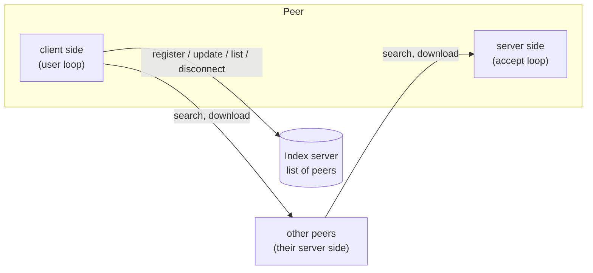
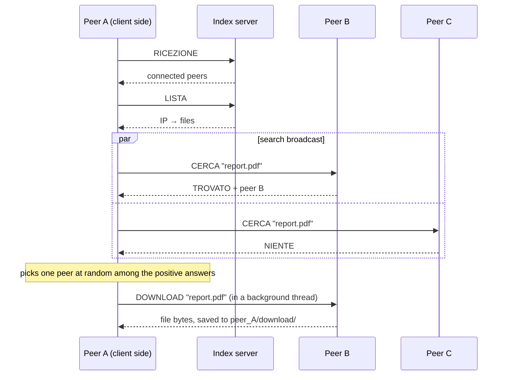

# Peer-to-peer file sharing: technical report

This report covers the requirements, the design of the index server and of the peers, the Java implementation, the deployment on Microsoft Azure with Docker, and the tests run for this repository. It is based on the original project report. Personal data and cloud-account identifiers have been left out.

## Contents
1. [Requirements](#1-requirements)
2. [Analysis and architecture](#2-analysis-and-architecture)
3. [Design](#3-design)
4. [Implementation](#4-implementation)
5. [Deployment: Azure and Docker](#5-deployment-azure-and-docker)
6. [Tests, fixes and limitations](#6-tests-fixes-and-limitations)

---

## 1. Requirements
Build an application that implements a distributed peer-to-peer file-sharing service:
- the application **registers with a server**, which returns the addresses of all connected nodes;
- the user can then **search a file by name**. The application sends the request to **all active peers**, selects **one** of those that answer positively, and downloads the file from it. The other peers are told that the request is no longer needed;
- when the application **receives a download request**, it looks for the file locally and, if present, offers to send it;
- when the user asks to quit, the application **sends a termination message to the server** and **waits for the downloads in progress**;
- the system must use the computing, storage and virtualisation services of **Microsoft Azure**.

## 2. Analysis and architecture
The problem splits into five sub-problems:
1. a connection between the application and the **index server** (registration and list of nodes);
2. a **search** feature that contacts every active peer;
3. **peer selection** among the positive answers, then the download;
4. **answering** download requests;
5. **graceful termination**.

This leads to two components:

**Index server.** It tracks the nodes of the network: it listens for registrations and stores the peers in a list. That list *is* the network at the abstract level. It also serves the other requests a node can send:
- **disconnection**: remove the peer;
- **network update**: send the peer list again;
- **availability**: for information, send a map from each node to its shared files.

**Peer.** It has two roles at the same time:
- *client*: it sends requests to the index server, broadcasts a search to all peers and collects the answers, chooses one of the peers that offered the file and requests the download, and disconnects correctly on exit after waiting for its downloads;
- *server*: it answers search requests (positively if the file is in its shared folder, with an explicit negative answer otherwise) and, if chosen, sends the file over the same connection.

## 3. Design
**Technologies.** The design uses only the Java standard library:
- `ServerSocket` and `Socket` for the communication channels (index server ↔ peer and peer ↔ peer);
- **threads**, so that every request is handled asynchronously;
- **streams** for the data: object streams for requests and replies, a data stream for the file name, and the raw byte stream for the file contents.

**Index server.** It has three sections:
- *start-up*: a thread runs an accept loop and hands every connection to a new handler thread;
- *connection/disconnection*: done inside the handler;
- *shutdown*: closes the server socket.

The handler reads the request type and dispatches it with an if-else chain.

**Peer, server side.** It has the same structure as the index server. The handler dispatches `CERCA`, which checks whether the file is in the shared folder, and `DOWNLOAD`, which sends the file.

**Peer, client side.** The whole behaviour of the peer follows a loop driven by the user, after registering with the index server:
- **search** (`0`): read the file name, then in cascade refresh the peer list, show the files the network offers, ask every peer, select one, and start the download in a **separate thread** so the menu stays responsive. Search and download form one operation, because a user who searches wants to download;
- **idle** (`1`): stay available to the other peers for a time chosen by the user;
- **terminate** (`2`): close the server side, join the download threads still running, then disconnect from the index server.

**Cancelling the other offers.** Searches are stateless request/response exchanges. A peer that answers `TROVATO` reserves nothing, and only the selected peer receives `DOWNLOAD`. The request is therefore implicitly cancelled for every other peer, and no explicit message is needed.

## 4. Implementation
| Class | Role |
|---|---|
| `NodoIndexServer.IndexServer` | holds the list of `PeerClientServer`; `inizia()` runs the accept loop in its own thread; `TERMINA` on stdin stops it |
| `NodoIndexServer.RichiesteServerHandler` | one thread per connection; handles `REGISTRAZIONE`, `RICEZIONE`, `LISTA` and `DISCONNESSIONE` inside `synchronized (peerConnessi)` |
| `NodoPeer.PeerClientServer` | a `Serializable` peer descriptor (IP, port, shared files, folder) and the peer program: server side (`initLatoServer`) and client side (`avviaClient`, `cercaFile`, `selezionaPeer`, `downloadFileDalPeer`, …) |
| `NodoPeer.RichiestePeerHandler` | one thread per incoming request; handles `CERCA` and `DOWNLOAD` |

Implementation details:
- **Peer identity.** A peer is identified by IP, port and shared files. `equals`/`hashCode` are overridden so the index server can remove the right peer on disconnection, and a peer can exclude itself from the search.
- **Shared folder.** Peer N shares `<base>/peer_N`, where `<base>` is the first command-line argument. Its files are listed at start-up (the `download` sub-folder excluded) and sent with the registration.
- **Transfers** use 4 KB buffers. The file name travels as modified UTF-8 (`DataOutputStream.writeUTF`), so names with non-ASCII characters are preserved.
- **Simulated transfer time.** The sending peer waits a random 10–50 s before streaming the file. This makes it possible to show during the demo that termination waits for the downloads in progress.

## 5. Deployment: Azure and Docker
**Azure.** The system ran on an Azure virtual machine:
- Ubuntu 22.04 LTS with an Xfce desktop;
- size *Standard B2s* (2 vCPU, 4 GiB RAM), from an *Azure for Students* subscription.

The first access went through **Azure Bastion** in the portal, which was used to enable **RDP**. After that, the VM was reached through Windows Remote Desktop and `xrdp`.

**Docker.** To simulate a network with several nodes on the VM, every node ran in its own container:
- **two images**, one per program, each built from a jar. The base image was `openjdk:14`;
- `CMD ["java", "-jar", "IndexServer.jar"]` for the index server;
- `CMD ["java", "-jar", "PeerClientServer.jar", "/app/data/peer_"]` for a peer, so peer N shares `/app/data/peer_N`;
- a **custom bridge network** (`docker network create …`) connecting all containers. The Docker engine gives every container its own IP address, as in a real network;
- a **volume** binding a host folder to `/app/data` in every peer container (`docker run -it -v <host_folder>:/app/data …`). Without it, downloaded files would stay in the container's union file system and would not be visible on the host.

This repository reproduces the same setup with a single multi-stage `Dockerfile`, which compiles both jars and runs them on `eclipse-temurin:17-jre` because the `openjdk` images are deprecated. A `docker-compose.yml` defines the index server, three peers, the network and the volume. Inside that network, the peers can reach the index server by its service name, `indexserver`.

## 6. Tests, fixes and limitations
**End-to-end test** (JDK 17, local machine). An index server and three peers ran with their interactive prompts driven by a script:
- the three peers registered (the server log shows 3 registrations);
- peer 2 searched `hello.txt`, shared by peers 1 and 3: it got **2 positive answers**, chose one and downloaded it;
- peer 2 also downloaded a **200,000-byte random binary file**, which arrived **byte-for-byte identical**;
- `TERMINA` was given while the downloads were still running: the peer waited about 46 s for them, then the index server acknowledged the disconnection.

**Docker test** (Docker 29, Compose 2.40). The test was repeated with `docker compose up --build`, one container per node:
- the image builds from source;
- every container gets its own address on the `p2p` network, and the peers reach the index server by its service name `indexserver`;
- the 3 registrations, the 2 positive answers, both downloads (written to the host through the `demo/` volume, with the binary file identical) and the clean shutdown behave as in the local test;
- `docker compose down` removes all containers and the network.

The compose file keeps `stdin_open` but no TTY. The programs only read lines, and this way the containers can be driven both by a person (`docker attach --sig-proxy=false`) and by a script.

**Fixes compared with the course submission:**
1. *Corrupted downloads.* The sending peer created an `ObjectOutputStream` on the socket before reading the request type. The constructor immediately writes the 4-byte serialisation header (`AC ED 00 05`), which then preceded the file bytes, so every downloaded file had 4 extra bytes at the start. The stream is now created only to answer `CERCA`.
2. *Peer selection.* `random.nextInt(size - 1)` never chose the last peer (and with two candidates always chose the first). It is now `random.nextInt(size)`.

**Limitations:**
- Java serialisation over plain TCP, with no authentication or encryption, is acceptable only on a trusted network.
- The `LISTA` map is keyed by IP address, so peers on the same host overwrite each other in the listing (searches are not affected).
- There is no heartbeat: a peer that crashes stays registered until the next search fails to reach it.
- The shared files are listed once, at start-up.
- Downloads are written in append mode, so downloading the same file twice concatenates the two copies.
- The index server holds the lock on the peer list for the whole request, including network I/O, so its requests are effectively serialised.
